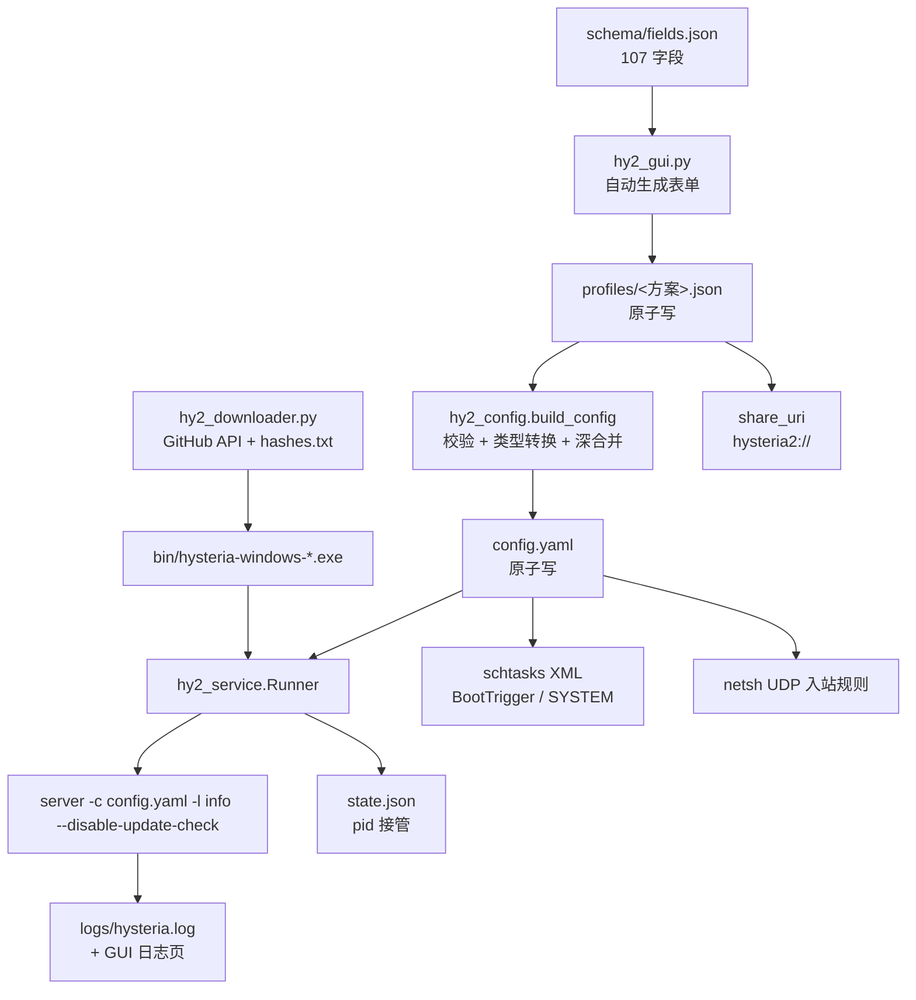

# Mr-Hy2 Win

一个带图形界面的 Hysteria2 **服务端**安装部署程序：负责下载并校验官方 Windows 内核、可视化编辑全套服务端配置、生成 `config.yaml`、启动/停止进程、采集日志、注册开机自启、放行防火墙，以及生成客户端分享链接。

| 项目 | 值 |
| --- | --- |
| 部署器版本 | 1.0 |
| 已验证内核 | `app/v2.14.0`（2026-11-15 发布） |
| 内核文件 | `hysteria-windows-amd64.exe`，25082 KB |
| 内核 SHA256 | `6ee18e99f826670a249ad20400c536900cb6fb5369237e30768df9032ac92d80` |
| 表单规模 | 11 个页签 / 107 个字段，全部定义在 `schema/fields.json` |
| 验证环境 | Windows / Python 3.12.3 / PyYAML 6.0.4 / tkinter 8.6 |
| 发行产物 | `dist/Hysteria2Deployer.exe`（GUI）、`dist/hy2ctl.exe`（CLI） |
| 仓库地址 | https://github.com/wcwtfhvk/mr-hy2-win |
| 随仓库附带 | `bin/` 内核、`dist/` 两个 exe、`profiles/` 示例方案、两个 `*.spec` |

---

## 目录

1. 项目定位
2. 功能清单
3. 环境与前置条件
4. 目录结构
5. 快速开始
6. GUI 详解
7. 配置项完整参考
8. 生成的配置样例
9. CLI 命令参考
10. 运行原理
11. 模块与接口
12. 扩展新字段
13. 打包与发布
14. 平台限制与已知边界
15. 排错
16. 安全
17. 测试与验证记录
18. 参考链接
19. 许可

---

## 1. 项目定位

Hysteria2 官方只提供单个可执行文件，Windows 下没有安装器、没有服务封装、没有配置编辑器。本程序补齐这一段：

```
官方内核 (hysteria-windows-*.exe)  ←→  本部署器  ←→  使用者
       协议实现 / QUIC / TLS              配置与生命周期管理
```

本程序**不实现代理协议**，不修改内核二进制。它做的全部事情是：把表单值转换成官方格式的 YAML、以 `server -c config.yaml` 启动内核、管理这个子进程及其运行环境。生成的配置可以直接被官方内核读取，也可以脱离本程序单独使用。

设计原则：

- **字段外置**：所有配置项在 `schema/fields.json`，GUI 由 schema 自动生成，改字段不用改 Python 代码。
- **模块独立**：配置模型、下载器、进程管理、GUI、CLI 各自可单独导入和测试，互不依赖界面。
- **原子写**：配置方案、`config.yaml`、运行状态都先写临时文件再替换，写一半不会损坏原文件。
- **零额外服务依赖**：不需要 pywin32、psutil、nssm、数据库；进程用 `subprocess` + `tasklist/taskkill`，自启用系统自带 `schtasks`，防火墙用 `netsh`。
- **不隐藏配置**：任何时刻都能在「配置预览」页看到最终 YAML，也能导出成文件交给官方内核直接运行。

---

## 2. 功能清单

| 能力 | 说明 |
| --- | --- |
| 内核下载 | 从 GitHub releases 或 `download.hysteria.network` 拉取，支持 `amd64` / `amd64-avx` / `386` / `arm64`，支持固定 tag 或 `latest` |
| 完整性校验 | 读取官方 `hashes.txt`，比对 SHA256，不匹配立即删除下载文件并报错 |
| 配置编辑 | 11 页签覆盖官方《完整服务端配置》的绝大部分字段；下拉、勾选、多行文本、可增删表格 |
| 条件联动 | 选择 `tls` 时 ACME 字段自动禁用，选择 `gecko` 时才启用分片参数等 |
| 多配置方案 | 新建 / 另存 / 删除 / 切换，每个方案一个 JSON，适合多机、多域名、多套策略 |
| 导入导出 | 导入已有 `config.yaml` 回填表单；导出生成的 YAML 到任意路径 |
| 校验 | 20+ 条规则：示例域名、Windows 端口范围、tls/acme 互斥、认证必填、带宽格式、Gecko 分片边界、ACL YAML、出站 JSON |
| 进程管理 | 启动 / 停止 / 状态查询，跨 GUI 重启按 PID 文件接管 |
| 实时日志 | 后台线程读 stdout/stderr，写入 `logs/hysteria.log` 并显示在界面 |
| 开机自启 | 生成 UTF-16 任务 XML，`BootTrigger` + `SYSTEM` + 失败重启 3 次 |
| 防火墙 | 按 `listen` 解析单端口，添加/删除 UDP 入站规则 |
| 分享链接 | 按官方 URI Scheme 生成 `hysteria2://`，含 auth、obfs、fragment，自动复制到剪贴板 |
| 无界面 CLI | 13 个命令，可用于自动化脚本、CI 校验、无桌面环境 |
| 单文件发行 | PyInstaller 打出一个 GUI exe 和一个 CLI exe，无需安装 Python |

---

## 3. 环境与前置条件

### 3.1 系统

- Windows 10 / 11 / Server 2016 及以上，x86-64 或 ARM64。
- 源码运行需要 Python 3.10+，且编译时带 `tkinter`（python.org 官方安装包默认包含）。精简版/嵌入式 Python 可能没有 tkinter。
- 唯一第三方依赖：`PyYAML>=6.0`。
- 使用发行版 exe 时不需要 Python，也不需要安装任何运行库。

### 3.2 网络

| 用途 | 需要的访问 |
| --- | --- |
| 查最新版本 | `api.github.com` |
| 下载内核 | `download.hysteria.network` 或 `github.com/HyNetworks/hysteria/releases` |
| 读校验文件 | `github.com/.../hashes.txt` |
| ACME HTTP-01 | 公网 **TCP 80** 能被 CA 访问 |
| ACME TLS-ALPN-01 | 公网 **TCP 443** 能被 CA 访问 |
| 客户端连入 | 公网 **UDP** 监听端口（默认 443）放行 |
| 伪装反代 | 服务端能访问 `masquerade.proxy.url` 指向的站点 |
| ACL 地理库 | 使用 `geoip()`/`geosite()` 规则时，内核启动会下载数据库到工作目录 |

GitHub API 不可用时下载器会自动降级到官方直链 `https://download.hysteria.network/app/latest/<文件名>`，并把结果记为 `verified: false`（无法取得对应 tag 的校验值）。

### 3.3 权限

| 操作 | 是否需要管理员 |
| --- | --- |
| 编辑配置、生成 YAML、启动/停止内核、看日志 | 否 |
| 注册/删除开机自启计划任务 | **是** |
| 添加/删除防火墙规则 | **是** |
| 监听 1024 以下端口 | Windows 不要求管理员，但端口不能已被占用 |

程序右下角状态栏会显示「管理员 / 普通用户」。非管理员点自启或防火墙会明确报 `PermissionError`，不会静默失败。

### 3.4 域名与证书

ACME 模式要求：一个已解析到本机公网 IP 的域名，且 80 或 443 可从公网访问。没有域名或只有内网环境时，改用「自有证书」模式（`tls.cert` / `tls.key`），客户端侧配 `insecure` 或 `pinSHA256`。

---

## 4. 目录结构

```
mr-hy2-win/
├─ main.py                  统一入口；无参数启 GUI，带子命令走 CLI
├─ cli.py                   13 个无界面命令的实现
├─ hy2_config.py            配置模型：默认值、校验、YAML 生成、分享 URI、反向导入
├─ hy2_downloader.py        版本发现、下载、SHA256 校验、架构判定
├─ hy2_service.py           Runner（进程 + 日志）、计划任务、防火墙
├─ hy2_gui.py               tkinter GUI（App / ScrollFrame / ListEditor）
├─ schema/
│  └─ fields.json           11 页签 107 字段，唯一字段来源
├─ profiles/                配置方案，每个方案一个 .json
├─ bin/                     Hysteria2 内核 + version.json
├─ logs/
│  └─ .gitkeep              目录占位；运行日志写入 hysteria.log（不入库）
├─ config.yaml              当前生效配置，由「保存并生成」写出
├─ state.json               运行中内核的 pid / exe / config / cmd
├─ autostart-task.xml       生成给 schtasks 的任务定义
├─ tests/
│  └─ test_core.py          25 个单元测试
├─ requirements.txt         PyYAML>=6.0
├─ build.bat                PyInstaller 打包脚本
├─ dist/                    打包产物
│  ├─ Hysteria2Deployer.exe GUI 主程序（11 MB）
│  ├─ hy2ctl.exe            CLI 程序（11 MB）
│  ├─ bin/                  已附带的内核（25 MB）
│  └─ profiles/             打包版自己的配置方案目录
└─ README.md                本文件
```

打包成 exe 后，`ROOT` 指向 exe 所在目录，`RESOURCE_DIR` 指向 PyInstaller 的 `_MEIPASS`。因此 `profiles/`、`bin/`、`logs/`、`config.yaml` 都会写在 exe 旁边，而不是解压临时目录，重启不会丢。`dist/` 下的两个 exe 请放在同一个目录使用。

Git 仓库随附源码、字段定义、测试、文档，以及 `bin/`（官方内核 + `version.json`）、`dist/`（两个 exe、附带内核、示例方案）、`profiles/default.json`（示例方案）、`logs/.gitkeep` 和两个 `*.spec`。`.gitignore` 只排除 `.venv/`、`build/`、`__pycache__/`、`logs/*.log`、`config.yaml`、`state.json`、`autostart-task.xml`：这些是环境/构建缓存与运行时状态，clone 后由 `ensure_dirs()` 自行创建。`profiles/default.json` 里的密码是示例随机值，部署前必须替换。

---

## 5. 快速开始

### 5.1 发行包直接运行（推荐）

`dist/` 里的两个 exe 已随仓库提供，也可用 `build.bat` 重新生成。拿到之后：

1. 进入 `dist/`。
2. 双击 `Hysteria2Deployer.exe`。
3. 若 `dist/bin/` 里已附带内核则无需再下载；否则点「下载 / 更新内核」。

命令行版（在 `dist/` 目录下执行）：

```bat
hy2ctl.exe selftest
hy2ctl.exe status
```

### 5.2 源码运行

```bat
git clone https://github.com/wcwtfhvk/mr-hy2-win.git
cd mr-hy2-win
python -m venv .venv
.venv\Scripts\python.exe -m pip install -r requirements.txt
.venv\Scripts\python.exe main.py download --arch amd64 --version latest
.venv\Scripts\python.exe main.py
```

仓库已附带 `bin/` 内核和 `dist/` 可执行文件，clone 后可跳过代码块里的 `download`（那一行只用于升级内核或换架构）。`config.yaml`、`state.json`、运行日志仍是本地生成、不入库，目录由 `ensure_dirs()` 自动创建。

不弹窗自检：

```bat
.venv\Scripts\python.exe main.py selftest
.venv\Scripts\python.exe main.py gui --selftest
```

### 5.3 首次必改的三项

默认配置自带示例值，**校验会主动拒绝保存**，防止拿示例域名去申请证书：

| 字段 | 页签 | 默认值 | 改成 |
| --- | --- | --- | --- |
| `_serverHost` | 基础 | `example.com` | 你的公网域名或 IP，只用于生成分享链接 |
| `acme.domains` | 证书 / TLS | `example.com` | 已解析到本机的域名 |
| `acme.email` | 证书 / TLS | `admin@example.com` | 真实邮箱（CA 通知用） |

`auth.password` 不需要手填：每次新建方案时用 `secrets.token_urlsafe(12)` 生成随机密码，可在「认证」页查看或点「生成分享链接」带出。

### 5.4 完整部署流程

1. **下载内核** — 底部「下载 / 更新内核」，状态栏显示百分比与 SHA256 校验结论。
2. **填配置** — 至少改完 5.3 的三项；按需要开混淆、带宽、ACL、API。
3. **校验** — 点「校验配置」，错误会逐条列出；提示类信息不阻塞。
4. **生成** — 点「保存并生成」，写出 `profiles/<方案>.json` 和 `config.yaml`。
5. **放行防火墙** — 以管理员运行后点「放行防火墙」，或 `hy2ctl.exe firewall --listen :443`。
6. **启动** — 点「启动」，去「运行日志」页确认出现 `server up and running`。
7. **自启** — 以管理员运行后点「开机自启」，或 `hy2ctl.exe task install --profile default`。
8. **分发** — 点「生成分享链接」，链接自动复制到剪贴板，导入客户端即可。

等价的纯命令行部署：

```bat
hy2ctl.exe download --arch amd64 --version latest
hy2ctl.exe gen --profile default --print
hy2ctl.exe start --profile default
```

`start` 是前台运行并实时打印日志，`Ctrl+C` 会停止内核。需要后台常驻用「开机自启」或 GUI 的「启动」。

---

## 6. GUI 详解

### 6.1 顶部工具栏

| 控件 | 作用 |
| --- | --- |
| 配置方案下拉框 | 切换方案，切换后表单和预览立即刷新 |
| 新建 | 输入方案名，生成一份带随机密码的默认方案 |
| 另存为 | 把当前表单另存成新方案 |
| 删除 | 删除当前方案（`default` 不可删） |
| 导入 YAML | 读已有 `config.yaml`，尽量回填表单，未识别顶层键进「高级」页 |
| 导出 YAML | 校验通过后把生成的 YAML 写到指定路径 |
| 内核标签 | 显示 `bin/version.json` 里的 tag 与架构 |

### 6.2 表单与条件联动

字段定义里的 `when` 决定生效条件。比如把「证书模式」从 `acme` 切到 `tls`，所有 `acme.*` 输入框立刻变灰，`tls.*` 变为可编辑；生成配置时也只输出被启用的那部分，不会把两套证书字段同时写进 YAML。

下拉、勾选、单行输入、多行文本、可增删表格五种控件：

- `list` 类型（域名、多用户、ACL 行、出站规则、STUN 服务器）用表格：添加 / 编辑 / 删除 / 上移 / 下移，双击行可编辑。
- `text` 类型的 `kv` 模式按每行 `key: value` 或 `key=value` 解析成映射。
- `text` 类型的 `yaml` 模式直接按 YAML 解析，用于新版 ACL 规则列表。
- `secret` 类型输入时隐藏字符，写入 JSON 方案时是明文（本地文件，注意保管）。

### 6.3 十一个页签

| 页签 | 管什么 | 对应官方配置段 |
| --- | --- | --- |
| 基础 | 公网域名、listen、内核架构/版本/日志等级、UDP 开关与超时、测速 | `listen` `disableUDP` `udpIdleTimeout` `speedTest` `ignoreClientBandwidth` |
| 证书 / TLS | ACME 与自有证书二选一、SNI 校验、客户端 CA、ECH | `acme` `tls` `ech` |
| 认证 | 单密码 / 多用户 / HTTP 后端 / 外部命令 | `auth` |
| 带宽 / 拥塞 | Brutal 上下行限速、拥塞控制器与 BBR 预设 | `bandwidth` `congestion` |
| 混淆 | 关闭 / Salamander / Gecko（含分片大小） | `obfs` |
| 伪装 | 关闭 / 反代 / 静态目录 / 固定字符串，以及额外 HTTP/HTTPS 监听 | `masquerade` |
| QUIC 参数 | 8 个底层 QUIC 窗口与超时参数 | `quic` |
| DNS / 嗅探 | UDP/TCP/DoT/DoH 解析器、协议嗅探端口 | `resolver` `sniff` |
| ACL / 出站 | 新版 rules / rulesFile / 旧版 inline / file，地理库，出站列表 | `acl` `outbounds` |
| API / Realm | 流量统计 API 监听与密钥、Realm 打洞调优 | `trafficStats` `realm` |
| 高级 | 附加 YAML，按顶层键深合并，覆盖表单未收录的字段 | 任意 |

### 6.4 运行日志页

后台线程逐行读内核 stdout/stderr，同时写入 `logs/hysteria.log` 并显示在界面。成功启动的标志是：

```
2026-11-27T14:58:24+08:00	INFO	server up and running	{"listen": ":55443"}
```

按钮：清空日志（只清界面）、打开日志目录。

### 6.5 配置预览页

实时显示 `config.yaml` 的完整内容。生成失败（如附加 YAML 语法错、出站附加参数不是合法 JSON）时，这里会显示 `# 生成失败: <原因>`，而不是写出半份配置。

### 6.6 底部操作按钮

| 按钮 | 行为 |
| --- | --- |
| 保存并生成 | 校验 → 写方案 JSON → 写 `config.yaml` → 刷新预览 → 弹窗列出提示 |
| 校验配置 | 只校验并弹窗，不写文件 |
| 下载 / 更新内核 | 后台线程下载，进度回状态栏，完成后刷新内核标签 |
| 启动 | 校验 → 写 `config.yaml` → `server -c ... -l <等级> --disable-update-check` |
| 停止 | 本实例用 `terminate`，GUI 重启过则按 `state.json` 的 pid 用 `taskkill /T /F` |
| 生成分享链接 | 生成 `hysteria2://` URI 并复制到剪贴板 |
| 开机自启 | 已安装则删除，未安装则创建；需管理员 |
| 放行防火墙 | 按 listen 端口加 UDP 入站规则；需管理员 |
| 刷新预览 | 重新生成 YAML 文本 |

状态栏每 2 秒刷新一次：`内核 运行中/已停止 | 管理员/普通用户 | 自启已开/自启未开`。日志是 0.5 秒轮询一次。

---

## 7. 配置项完整参考

字段键以点分路径表示，例如 `acme.http.altPort` 对应 YAML 里 `acme:` → `http:` → `altPort:`。以 `_` 开头的键是**程序内部模式变量**，不会写进服务端配置（只影响生成逻辑、命令行或分享链接）。「生效条件」列指该字段何时被写入 YAML。

### 7.1 基础（`basic`）

| 字段键 | 控件 | 默认值 | 生效条件 | 说明 |
| --- | --- | --- | --- | --- |
| `_serverHost` | 文本 | `example.com` | 始终 | 仅用于生成客户端分享链接，不写入服务端配置 |
| `listen` | 文本 | `:443` | 始终 | 省略地址则同时监听 IPv4/IPv6；Windows 不支持端口范围（端口跳跃仅 Linux） |
| `_arch` | 下拉（可选：`amd64` / `amd64-avx` / `386` / `arm64`） | `amd64` | 始终 | 下载时使用的 hysteria-windows-<架构>.exe |
| `_version` | 文本 | `latest` | 始终 | latest 或形如 app/v2.14.0 的 release tag |
| `_logLevel` | 下拉（可选：`info` / `debug` / `warn` / `error`） | `info` | 始终 | 日志等级 |
| `disableUDP` | 开关 | `false` | 始终 | 禁用 UDP 转发 |
| `udpIdleTimeout` | 文本 | `60s` | 始终 | UDP 会话超时 |
| `speedTest` | 开关 | `false` | 始终 | 允许客户端测速 |
| `ignoreClientBandwidth` | 开关 | `false` | 始终 | 忽略客户端带宽设置 |

### 7.2 证书 / TLS（`tls`）

> tls 与 acme 二选一，不可同时出现。ACME 需要域名已解析到本机、80/443 可被公网访问。

| 字段键 | 控件 | 默认值 | 生效条件 | 说明 |
| --- | --- | --- | --- | --- |
| `_tlsMode` | 下拉（可选：`acme` / `tls`） | `acme` | 始终 | 证书模式 |
| `acme.domains` | 表格 | `[{"domain": "example.com"}]` | `_tlsMode=acme` | ACME 域名列表 |
| `acme.email` | 文本 | `admin@example.com` | `_tlsMode=acme` | ACME 邮箱 |
| `acme.ca` | 下拉（可选：空 / `letsencrypt` / `zerossl`） | （空） | `_tlsMode=acme` | CA |
| `acme.dir` | 文本 | `acme` | `_tlsMode=acme` | 证书缓存目录 |
| `acme.type` | 下拉（可选：`http` / `tls` / `dns`） | `http` | `_tlsMode=acme` | 验证方式 |
| `acme.listenHost` | 文本 | `0.0.0.0` | `_tlsMode=acme` | 验证监听地址 |
| `acme.http.altPort` | 整数 | `80` | `_tlsMode=acme` | HTTP-01 端口 |
| `acme.tls.altPort` | 整数 | `443` | `_tlsMode=acme` | TLS-ALPN-01 端口 |
| `acme.dns.name` | 文本 | （空） | `_tlsMode=acme` | type=dns 时填写，如 cloudflare |
| `acme.dns.config` | 多行文本 | （空） | `_tlsMode=acme` | 每行 key=value |
| `tls.cert` | 文本 | （空） | `_tlsMode=tls` | 绝对路径或相对工作目录 |
| `tls.key` | 文本 | （空） | `_tlsMode=tls` | 私钥文件 key |
| `tls.sniGuard` | 下拉（可选：空 / `strict` / `disable` / `dns-san`） | （空） | `_tlsMode=tls` | SNI 校验 |
| `tls.clientCA` | 文本 | （空） | `_tlsMode=tls` | 客户端 CA |
| `_echEnabled` | 开关 | `false` | 始终 | 启用 ECH |
| `ech.keyPath` | 文本 | `ech.pem` | `_echEnabled=true` | ECH 密钥路径 |

### 7.3 认证（`auth`）

| 字段键 | 控件 | 默认值 | 生效条件 | 说明 |
| --- | --- | --- | --- | --- |
| `_authType` | 下拉（可选：`password` / `userpass` / `http` / `command`） | `password` | 始终 | 认证类型 |
| `auth.password` | 密码 | （空） | `_authType=password` | 新建配置时自动生成随机密码 |
| `auth.userpass` | 表格 | `[]` | `_authType=userpass` | 多用户 |
| `auth.http.url` | 文本 | （空） | `_authType=http` | HTTP 验证地址 |
| `auth.http.insecure` | 开关 | `false` | `_authType=http` | 跳过 TLS 校验 |
| `auth.command` | 文本 | （空） | `_authType=command` | 服务端会附加 addr auth tx 三个参数执行 |

### 7.4 带宽 / 拥塞（`bandwidth`）

> bandwidth 是 Brutal 的速率上限；不填则使用 congestion 指定的拥塞控制器（默认 BBR）。单位 bps/kbps/mbps/gbps/tbps。

| 字段键 | 控件 | 默认值 | 生效条件 | 说明 |
| --- | --- | --- | --- | --- |
| `_bandwidthEnabled` | 开关 | `false` | 始终 | 启用带宽限制 |
| `bandwidth.up` | 文本 | `100 mbps` | `_bandwidthEnabled=true` | 服务端上行 |
| `bandwidth.down` | 文本 | `1 gbps` | `_bandwidthEnabled=true` | 服务端下行 |
| `bandwidth.disableLossCompensation` | 开关 | `false` | `_bandwidthEnabled=true` | 关闭丢包补偿 |
| `_congestionEnabled` | 开关 | `false` | 始终 | 显式配置拥塞控制 |
| `congestion.type` | 下拉（可选：`bbr` / `reno`） | `bbr` | `_congestionEnabled=true` | 控制器 |
| `congestion.bbrProfile` | 下拉（可选：`standard` / `conservative` / `aggressive`） | `standard` | `_congestionEnabled=true` | BBR 预设 |

### 7.5 混淆（`obfs`）

> 启用混淆会失去标准 QUIC / HTTP3 伪装能力，客户端必须使用相同类型和密码。

| 字段键 | 控件 | 默认值 | 生效条件 | 说明 |
| --- | --- | --- | --- | --- |
| `_obfsType` | 下拉（可选：`none` / `salamander` / `gecko`） | `none` | 始终 | 混淆类型 |
| `obfs.salamander.password` | 密码 | （空） | `_obfsType=salamander` | Salamander 密码 |
| `obfs.gecko.password` | 密码 | （空） | `_obfsType=gecko` | Gecko 密码 |
| `obfs.gecko.minPacketSize` | 整数 | `512` | `_obfsType=gecko` | Gecko 最小分片 |
| `obfs.gecko.maxPacketSize` | 整数 | `1200` | `_obfsType=gecko` | 需 >= 最小分片且 <= 2048 |

### 7.6 伪装（`masquerade`）

> 不启用时服务端对所有 HTTP 请求返回 404。proxy 模式会反代指定站点。

| 字段键 | 控件 | 默认值 | 生效条件 | 说明 |
| --- | --- | --- | --- | --- |
| `_masqType` | 下拉（可选：`none` / `proxy` / `file` / `string`） | `proxy` | 始终 | 伪装模式 |
| `masquerade.proxy.url` | 文本 | `https://news.ycombinator.com/` | `_masqType=proxy` | 反代目标 URL |
| `masquerade.proxy.rewriteHost` | 开关 | `true` | `_masqType=proxy` | 重写 Host |
| `masquerade.proxy.insecure` | 开关 | `false` | `_masqType=proxy` | 跳过上游 TLS 校验 |
| `masquerade.proxy.xForwarded` | 开关 | `false` | `_masqType=proxy` | 发送 X-Forwarded-For |
| `masquerade.file.dir` | 文本 | `www` | `_masqType=file` | 静态目录 |
| `masquerade.string.content` | 文本 | `hello world` | `_masqType=string` | 固定响应内容 |
| `masquerade.string.headers` | 多行文本 | `content-type: text/plain` | `_masqType=string` | 响应头 |
| `masquerade.string.statusCode` | 整数 | `200` | `_masqType=string` | 状态码 |
| `_masqHttpEnabled` | 开关 | `false` | 始终 | 额外监听 HTTP/HTTPS 伪装 |
| `masquerade.listenHTTP` | 文本 | `:80` | `_masqHttpEnabled=true` | HTTP 监听 |
| `masquerade.listenHTTPS` | 文本 | `:443` | `_masqHttpEnabled=true` | HTTPS 监听 |
| `masquerade.forceHTTPS` | 开关 | `true` | `_masqHttpEnabled=true` | 强制跳转 HTTPS |

### 7.7 QUIC 参数（`quic`）

> 默认值已足够。修改时建议保持流窗口与连接窗口 2:5 的比例。

| 字段键 | 控件 | 默认值 | 生效条件 | 说明 |
| --- | --- | --- | --- | --- |
| `_quicEnabled` | 开关 | `false` | 始终 | 覆盖 QUIC 默认参数 |
| `quic.initStreamReceiveWindow` | 整数 | `8388608` | `_quicEnabled=true` | 初始流接收窗口 |
| `quic.maxStreamReceiveWindow` | 整数 | `8388608` | `_quicEnabled=true` | 最大流接收窗口 |
| `quic.initConnReceiveWindow` | 整数 | `20971520` | `_quicEnabled=true` | 初始连接接收窗口 |
| `quic.maxConnReceiveWindow` | 整数 | `20971520` | `_quicEnabled=true` | 最大连接接收窗口 |
| `quic.maxIdleTimeout` | 文本 | `30s` | `_quicEnabled=true` | 最大空闲超时 |
| `quic.maxIncomingStreams` | 整数 | `1024` | `_quicEnabled=true` | 最大并发流 |
| `quic.disablePathMTUDiscovery` | 开关 | `false` | `_quicEnabled=true` | 禁用 Path MTU 探测 |
| `quic.disableStatelessReset` | 开关 | `false` | `_quicEnabled=true` | 禁用无状态重置 |

### 7.8 DNS / 嗅探（`dns`）

| 字段键 | 控件 | 默认值 | 生效条件 | 说明 |
| --- | --- | --- | --- | --- |
| `_resolverType` | 下拉（可选：`none` / `udp` / `tcp` / `tls` / `https`） | `none` | 始终 | none 表示使用系统默认 DNS |
| `resolver.udp.addr` | 文本 | `8.8.4.4:53` | `_resolverType=udp` | UDP DNS 地址 |
| `resolver.udp.timeout` | 文本 | `4s` | `_resolverType=udp` | UDP 超时 |
| `resolver.tcp.addr` | 文本 | `8.8.8.8:53` | `_resolverType=tcp` | TCP DNS 地址 |
| `resolver.tcp.timeout` | 文本 | `4s` | `_resolverType=tcp` | TCP 超时 |
| `resolver.tls.addr` | 文本 | `1.1.1.1:853` | `_resolverType=tls` | DoT 地址 |
| `resolver.tls.timeout` | 文本 | `10s` | `_resolverType=tls` | DoT 超时 |
| `resolver.tls.sni` | 文本 | `cloudflare-dns.com` | `_resolverType=tls` | DoT SNI |
| `resolver.tls.insecure` | 开关 | `false` | `_resolverType=tls` | DoT 跳过校验 |
| `resolver.https.addr` | 文本 | `1.1.1.1:443` | `_resolverType=https` | DoH 地址 |
| `resolver.https.timeout` | 文本 | `10s` | `_resolverType=https` | DoH 超时 |
| `resolver.https.sni` | 文本 | `cloudflare-dns.com` | `_resolverType=https` | DoH SNI |
| `resolver.https.insecure` | 开关 | `false` | `_resolverType=https` | DoH 跳过校验 |
| `_sniffEnabled` | 开关 | `false` | 始终 | 启用协议嗅探 |
| `sniff.timeout` | 文本 | `2s` | `_sniffEnabled=true` | 嗅探超时 |
| `sniff.rewriteDomain` | 开关 | `false` | `_sniffEnabled=true` | 重写域名 |
| `sniff.tcpPorts` | 文本 | `80,443` | `_sniffEnabled=true` | TCP 端口范围 |
| `sniff.udpPorts` | 文本 | `all` | `_sniffEnabled=true` | UDP 端口范围 |

### 7.9 ACL / 出站（`acl`）

> 新版 rules 用表达式语法；inline / file 为旧版语法。四选一。未配置 ACL 时所有流量走第一个出站。

| 字段键 | 控件 | 默认值 | 生效条件 | 说明 |
| --- | --- | --- | --- | --- |
| `_aclMode` | 下拉（可选：`none` / `rules` / `rulesFile` / `inline` / `file`） | `none` | 始终 | ACL 模式 |
| `acl.rules` | 多行文本 | （空） | `_aclMode=rules` | 示例：<br>- outbound: reject<br>  match: geoip("cn")<br>- outbound: direct |
| `acl.rulesFile` | 文本 | `acl.yaml` | `_aclMode=rulesFile` | 新版规则文件 |
| `acl.inline` | 表格 | `[]` | `_aclMode=inline` | 例如 reject(all, udp/443) |
| `acl.file` | 文本 | `acl.txt` | `_aclMode=file` | 旧版规则文件 |
| `acl.geoip` | 文本 | （空） | `_aclMode=rules` | GeoIP 数据库路径 |
| `acl.geosite` | 文本 | （空） | `_aclMode=rules` | GeoSite 数据库路径 |
| `acl.geoUpdateInterval` | 文本 | `168h` | `_aclMode=rules` | 地理库刷新间隔 |
| `outbounds` | 表格 | `[]` | 始终 | 附加参数示例：direct -> {"mode":"auto"}；socks5 -> {"addr":"1.2.3.4:1080"}；http -> {"url":"http://a:b@host:8080"} |

### 7.10 API / Realm（`api`）

> Realm 用于无公网 IP 的 NAT 环境；启用后 listen 需填 realm://TOKEN@rendezvous/name。

| 字段键 | 控件 | 默认值 | 生效条件 | 说明 |
| --- | --- | --- | --- | --- |
| `_statsEnabled` | 开关 | `false` | 始终 | 启用流量统计 API |
| `trafficStats.listen` | 文本 | `:9999` | `_statsEnabled=true` | API 监听地址 |
| `trafficStats.secret` | 密码 | （空） | `_statsEnabled=true` | API 密钥 |
| `_realmEnabled` | 开关 | `false` | 始终 | 输出 Realm 调优参数 |
| `realm.stunServers` | 表格 | `[]` | `_realmEnabled=true` | STUN 服务器 |
| `realm.stunTimeout` | 文本 | `5s` | `_realmEnabled=true` | STUN 超时 |
| `realm.punchTimeout` | 文本 | `5s` | `_realmEnabled=true` | 打洞超时 |
| `realm.heartbeatInterval` | 文本 | `30s` | `_realmEnabled=true` | 心跳间隔 |
| `realm.insecure` | 开关 | `false` | `_realmEnabled=true` | 跳过 Rendezvous 校验 |
| `realm.ipMode` | 下拉（可选：`dual` / `4` / `6`） | `dual` | `_realmEnabled=true` | IP 模式 |
| `realm.portMapping.enabled` | 开关 | `false` | `_realmEnabled=true` | 启用端口映射 |
| `realm.portMapping.timeout` | 文本 | `10s` | `_realmEnabled=true` | 映射超时 |
| `realm.portMapping.lifetime` | 文本 | `10m` | `_realmEnabled=true` | 映射有效期 |

### 7.11 高级（`advanced`）

> 下方 YAML 会按顶层键深合并进最终配置，用于覆盖表单未收录的新字段。键名与 Hysteria 官方一致。

| 字段键 | 控件 | 默认值 | 生效条件 | 说明 |
| --- | --- | --- | --- | --- |
| `_advancedYaml` | 多行文本 | （空） | 始终 | 例如：<br>quic:<br>  maxIdleTimeout: 60s |

---

## 8. 生成的配置样例

以下三份 YAML 均由 `hy2_config.build_config()` 实际生成，字段名与官方《完整服务端配置》一致。示例密码 `Se7RAuFZ8Lzg` 来自官方文档，实际使用必须替换。

### 8.1 ACME 最小可用配置

```yaml
listen: :443
disableUDP: false
udpIdleTimeout: 60s
speedTest: false
ignoreClientBandwidth: false
acme:
  domains:
  - hy.example.net
  email: admin@hy.example.net
  dir: acme
  type: http
  listenHost: 0.0.0.0
  http:
    altPort: 80
auth:
  password: Se7RAuFZ8Lzg
  type: password
masquerade:
  proxy:
    url: https://news.ycombinator.com/
    rewriteHost: true
    insecure: false
    xForwarded: false
  type: proxy
```

启动命令：

```bat
hysteria-windows-amd64.exe server -c config.yaml -l info --disable-update-check
```

### 8.2 自有证书 + 无伪装

```yaml
listen: :443
disableUDP: false
udpIdleTimeout: 60s
speedTest: false
ignoreClientBandwidth: false
tls:
  cert: C:/hysteria/fullchain.pem
  key: C:/hysteria/privkey.pem
auth:
  password: Se7RAuFZ8Lzg
  type: password
```

### 8.3 全功能配置（混淆 + 限速 + ACL + 出站 + API）

```yaml
listen: :443
disableUDP: false
udpIdleTimeout: 60s
speedTest: false
ignoreClientBandwidth: false
acme:
  domains:
  - hy.example.net
  email: admin@hy.example.net
  dir: acme
  type: http
  listenHost: 0.0.0.0
  http:
    altPort: 80
auth:
  password: Se7RAuFZ8Lzg
  type: password
bandwidth:
  up: 100 mbps
  down: 1 gbps
  disableLossCompensation: false
obfs:
  type: salamander
  salamander:
    password: cry_me_a_r1ver
masquerade:
  proxy:
    url: https://news.ycombinator.com/
    rewriteHost: true
    insecure: false
    xForwarded: false
  type: proxy
sniff:
  enable: true
  timeout: 2s
  rewriteDomain: false
  tcpPorts: 80,443
  udpPorts: all
acl:
  rules:
  - outbound: reject
    match: geoip("cn")
  - outbound: direct
  geoUpdateInterval: 168h
outbounds:
- name: direct
  type: direct
  direct:
    mode: auto
- name: socks
  type: socks5
  socks5:
    addr: 127.0.0.1:1080
trafficStats:
  listen: :9999
  secret: s3cr3t-api-key
```

### 8.4 客户端分享链接

格式遵循官方 URI Scheme：`hysteria2://[auth@]host[:port]/?key=value#name`。

- `password` 认证：密码作为 userinfo，特殊字符百分号编码。
- `userpass` 认证：`username:password`，冒号是结构分隔符，不编码；程序取表格第一行生成。
- 开启混淆时自动附加 `obfs` 与 `obfs-password`。
- fragment 是配置方案名，供客户端显示。

示例：

```
hysteria2://Se7RAuFZ8Lzg@hy.example.net:443/?obfs=salamander&obfs-password=cry_me_a_r1ver#default
```

`http` / `command` 认证模式无法用单个 URI 表达密码，程序只输出基础地址。Realm 模式下 `listen` 是 `realm://...`，程序直接返回该地址。

---

## 9. CLI 命令参考

### 9.1 命令总表

| 命令 | 作用 | 主要参数 |
| --- | --- | --- |
| `gui` | 启动图形界面（默认命令） | `--profile` `--selftest` |
| `download` | 下载/更新内核并校验 | `--arch` `--version` |
| `validate` | 校验配置并打印生成的 YAML | `--profile` |
| `gen` | 生成 `config.yaml` | `--profile` `--out` `--print` |
| `share` | 输出客户端分享链接 | `--profile` |
| `status` | 运行状态 / 内核 / 自启 / 管理员 / 方案列表 | 无 |
| `start` | 前台启动内核并打印日志，Ctrl+C 停止 | `--profile` |
| `stop` | 按 pid 文件停止内核 | 无 |
| `task` | 开机自启计划任务 | `install` / `uninstall` / `status`，`--profile` |
| `firewall` | UDP 入站规则 | `--listen` `--remove` |
| `import` | 导入已有 config.yaml 为方案 | `--file` `--profile` |
| `profiles` | 列出所有配置方案 | 无 |
| `selftest` | 不启界面验证核心逻辑 | 无 |

不带任何参数等价于 `gui`；只给 `--xxx` 形式参数时也会自动补 `gui`。

### 9.2 逐条示例

```bat
:: 下载指定版本与架构
hy2ctl.exe download --arch amd64 --version app/v2.14.0

:: 校验并查看将生成的配置
hy2ctl.exe validate --profile default

:: 生成到指定路径并打印
hy2ctl.exe gen --profile default --out C:\hysteria\config.yaml --print

:: 导入一份旧配置，之后可在 GUI 里继续编辑
hy2ctl.exe import --file C:\hysteria\config.yaml --profile imported

:: 前台启动（Ctrl+C 停止）
hy2ctl.exe start --profile default

:: 停止 GUI 启动的内核
hy2ctl.exe stop

:: 以管理员运行：注册开机自启、放行 UDP 443
hy2ctl.exe task install --profile default
hy2ctl.exe firewall --listen :443
hy2ctl.exe task status

:: 卸载
hy2ctl.exe firewall --listen :443 --remove
hy2ctl.exe task uninstall
```

`status` 的输出是 JSON，便于脚本解析：

```json
{
  "running": false,
  "kernel": {"tag": "app/v2.14.0", "arch": "amd64", "verified": true},
  "autostart": false,
  "admin": false,
  "profiles": ["default"]
}
```

### 9.3 退出码

| 码 | 含义 |
| --- | --- |
| 0 | 成功 |
| 2 | 配置校验不通过 |
| 3 | 内核未安装 |
| 4 | 启动失败 |
| 5 | 计划任务/防火墙失败（多为权限不足或命令被拦截） |
| 6 | 导入文件顶层不是映射 |
| 7 | GUI 不可用（Python 缺 tkinter） |

---

## 10. 运行原理



关键实现点：

- **类型选择格式**：官方的 `example: {type: a, a: {...}, b: {...}}` 由模式变量注入 `type`，生成时只保留被选中的子块，避免无关子段污染配置。
- **校验前置**：保存、导出、启动、生成分享链接之前都走 `validate()`，错误逐条展示，不写坏文件。
- **高级 YAML 深合并**：附加 YAML 解析成 dict 后按顶层键递归合并，可以覆盖表单里的任何一层，也可以写入表单未收录的新字段。
- **PID 接管**：`state.json` 记录 pid / exe / config / 完整命令行。GUI 关闭后内核继续运行；重新启动 GUI 仍能通过 `tasklist` 查状态、用 `taskkill /T /F` 停止。
- **计划任务而非 Windows 服务**：普通 exe 不能直接注册为服务，因此用 `schtasks /Create /XML` 创建 `BootTrigger` + `SYSTEM` 任务，无需登录即可启动，并在任务里配了失败后 1 分钟重试 3 次。

---

## 11. 模块与接口

| 模块 | 主要接口 | 职责 |
| --- | --- | --- |
| `hy2_config` | `load_schema()` `fields()` `default_values()` `build_config(values)` `dump_yaml(cfg)` `write_config(values, path)` `validate(values)` `warnings(values)` `share_uri(values, name)` `values_from_yaml(cfg)` `load_profile()` `save_profile()` | 配置模型，纯逻辑，无 GUI 依赖 |
| `hy2_downloader` | `latest_release()` `filename_for(arch)` `parse_hashes(text)` `download(arch, version, progress)` `binary_path()` `installed_meta()` `binary_version(exe)` | 网络与文件完整性 |
| `hy2_service` | `Runner.start()` `.stop()` `.is_running()` `drain()` `log_tail()` `install_autostart()` `uninstall_autostart()` `autostart_status()` `firewall_allow_udp()` `is_admin()` | 进程与系统命令 |
| `hy2_gui` | `App(profile)` `launch(profile, selftest)` `ScrollFrame` `ListEditor` | 界面 |
| `cli` | `cmd_download` `cmd_gen` `cmd_validate` `cmd_start` `cmd_stop` `cmd_task` `cmd_firewall` `cmd_import` `cmd_selftest` | 无界面命令 |
| `main` | `main(argv)` `build_parser()` | 入口与参数分派 |

最小调用示例（不启界面生成配置）：

```python
import hy2_config as C

values = C.default_values()
values["_serverHost"] = "hy.example.net"
values["acme.domains"] = [{"domain": "hy.example.net"}]
values["acme.email"] = "admin@hy.example.net"

errors = C.validate(values)          # [] 表示通过
cfg = C.build_config(values)         # dict
text = C.dump_yaml(cfg)              # 官方格式 YAML
C.write_config(values, "config.yaml")
print(C.share_uri(values, "default"))
```

---

## 12. 扩展新字段

新增一个官方配置项只需在 `schema/fields.json` 对应页签的 `fields` 数组里加一项，GUI、校验、YAML 生成自动生效：

```json
{
  "key": "quic.maxIdleTimeout",
  "label": "最大空闲超时",
  "type": "str",
  "default": "30s",
  "hint": "例如 30s / 1m",
  "when": {"_quicEnabled": true}
}
```

字段属性：

| 属性 | 含义 |
| --- | --- |
| `key` | 点分路径；`_` 开头表示内部模式变量，不写进 YAML |
| `label` | 界面标签 |
| `type` | `str` `secret` `int` `bool` `choice` `text` `list`；另有 `note`（纯说明，无 key） |
| `default` | 默认值；`auth.password` 会被 `default_values()` 覆盖成随机值 |
| `options` | `choice` 类型的候选值 |
| `columns` / `transform` | `list` 类型的列定义与转换方式：`strings` / `userpass` / `outbounds` / `raw` |
| `as` | `text` 类型的解析方式：`kv` / `lines` / `yaml` / `raw` |
| `when` | 生效条件，形如 `{"_tlsMode": "acme"}`；同时控制界面禁用与 YAML 输出 |
| `hint` | 界面提示文字 |

新增字段后跑一次 `.venv\Scripts\python.exe main.py selftest`，会打印新的字段数与页签数。若新字段需要特殊校验，在 `hy2_config.validate()` 里加规则；需要特殊转换，在 `transform_value()` 或 `build_config()` 的模式处理段加。

---

## 13. 打包与发布

```bat
cmd /c build.bat
```

脚本做三件事：

1. 用 `.venv\Scripts\python.exe`（不存在则回退到 PATH 里的 `python`）安装 `requirements.txt` 与 `pyinstaller`。
2. 打 `--onefile --windowed --name Hysteria2Deployer`，`--add-data "schema;schema"` 把字段定义嵌进 exe。
3. 打 `--onefile --console --name hy2ctl`，供命令行使用。

产物在 `dist/`。两个 exe 放在同一目录即可；`profiles/`、`bin/`、`logs/`、`config.yaml` 会在该目录生成。发布时建议把已下载并校验过的 `bin/` 一起带上，用户开箱即用，不必联网。以上产物已随仓库提供，`build.bat` 可随时重新生成；只有 `build/` 中间目录不入库。

两个打包相关处理：

- **冻结路径**：`hy2_config` 检测 `sys.frozen`，把数据目录设为 `sys.executable` 所在目录、资源目录设为 `sys._MEIPASS`。否则 onefile 模式会把配置写进临时解压目录，重启即丢失。
- **控制台编码**：`main._fix_windows_console()` 调 `SetConsoleOutputCP(65001)` 并把 stdout/stderr reconfigure 成 UTF-8，避免中文在 936 代码页下乱码。GUI 版没有 stdout，异常被吞掉不影响运行。

体积参考：GUI exe 11 MB、CLI exe 11 MB、内核 25 MB。

---

## 14. 平台限制与已知边界

1. **端口跳跃不可用**。官方明确 `listen: :20000-50000` 这类端口范围监听仅支持 Linux（依赖 nftables/iptables）。`validate()` 会对含 `-` 或 `,` 的端口段报错，请改成单端口。
2. **mimic 不可用**。Linux + root + 内核模块专属功能，本程序不提供该配置项。
3. **计划任务不是 Windows 服务**。没有服务控制管理器里的停止/恢复语义；停止靠 `taskkill /T /F`，属于强制终止，正在传输的连接会断。
4. **ACME 端口约束**。`http` 验证改到非 80 端口、或 `tls` 验证改到非 443 端口，必须自行配端口转发/反代，否则签发失败。
5. **443 与 80 冲突**。IIS、其它 Web 服务占用时内核起不来；先看日志里的 `listen` 报错，或改 `listen` 到其它 UDP 端口并同步改防火墙规则。
6. **IPv6 地址要加引号**。像 `[2001:db8::1]:443` 这类值在 YAML 里需写成 `"[2001:db8::1]:443"`，否则解析失败。
7. **导入不是 100% 可逆**。`values_from_yaml()` 覆盖表单收录的字段；旧版语法、未来新增字段会落进「高级」页的附加 YAML，不会丢，但也不会拆成独立控件。
8. **附加 YAML 是合并不是替换**。同名顶层键会按层级深合并，标量以附加 YAML 为准。想完全覆盖某个段，先在表单里关掉它。
9. **分享链接只含连接基础信息**。按官方规范，不含客户端模式（HTTP/SOCKS5）和带宽值，这些由客户端自己配。
10. **API secret 不填只是提示**，不阻塞启动，但任何能访问该端口的人都能查询流量和踢用户。
11. **`trafficStats` 与 ACL 地理库**会在内核侧产生额外网络访问（数据库自动下载），离线环境需预置 `acl.geoip` / `acl.geosite` 文件。

---

## 15. 排错

| 现象 | 原因 | 处理 |
| --- | --- | --- |
| 点「启动」提示缺少内核 | `bin/` 下没有对应架构的 exe | 点「下载 / 更新内核」，或 `hy2ctl.exe download --arch amd64` |
| 校验报「ACME 域名还是示例值」 | `acme.domains` 还是 `example.com` | 改成自己的域名，同时改 `_serverHost` 和 `acme.email` |
| 校验报「Windows 不支持端口范围」 | `listen` 写了 `:20000-50000` 或 `443,5000-6000` | 改成单个端口，如 `:443` |
| 生成失败：附加 YAML 解析失败 | 「高级」页 YAML 语法错，或顶层是列表 | 改成 `key: value` 形式的映射，参考「配置预览」页报错 |
| 生成失败：出站附加参数 JSON 解析失败 | 出站表格 `extra` 列不是合法 JSON 对象 | 写成 `{"addr": "1.2.3.4:1080"}`，注意双引号 |
| ACME 签发失败 / 一直等待 | 域名未解析到本机，或 80/443 被防火墙/云安全组拦 | 先确认公网可达；`acme.dir` 目录留空让它重新申请 |
| 客户端连不上，但日志显示 `server up and running` | UDP 端口未放行 | 管理员运行 `hy2ctl.exe firewall --listen :443`，同时检查云厂商安全组 UDP 规则 |
| 开机自启点不动 / 报 PermissionError | 不是管理员 | 右键「以管理员身份运行」后再执行 |
| 开机自启装了但不启动 | 任务路径指向的 exe/config 被移动 | 重新执行 `hy2ctl.exe task install`，或 `schtasks /Query /TN "Hysteria2 Server"` 查任务 |
| CLI 中文乱码 | 旧版打包未切 UTF-8 代码页 | 用当前 `build.bat` 重新打包；或临时 `chcp 65001` |
| 日志页空白 | 内核没输出或启动即退出 | 打开 `logs/hysteria.log`；用 `start` 命令前台跑看完整错误 |
| `status` 显示 running 但端口没监听 | pid 复用或旧 `state.json` 残留 | 执行 `hy2ctl.exe stop`，再检查 `state.json` 是否被清除 |
| 端口被占用 | 443 UDP 已被别的进程占用 | 执行 `netstat -ano -p udp` 查占用 443 的 pid，改 `listen` 或停掉占用者 |

---

## 16. 安全

- 仓库里的 `profiles/default.json` 与 `dist/profiles/default.json` 是示例方案，密码为首次运行时生成的示例随机值，部署前必须替换。改成自己的配置后，带真实密码的方案文件不要提交回仓库。
- 自有证书模式下 `tls.key` 是私钥，路径建议用绝对路径并限制 ACL。
- 防火墙只放行 `listen` 指定的那一个 UDP 端口；`trafficStats.listen` 不要暴露到公网，务必设 `secret`。
- 下载器默认做 SHA256 校验；若因 GitHub API 不可用走了官方直链而显示「未取得官方校验值」，`bin/version.json` 里会记录 `verified: false` 和本地哈希，可自行与官方 `hashes.txt` 核对。
- 新建方案的认证密码由 CSPRNG 生成，不要改成弱口令。
- 需要管理员权限的操作只有自启和防火墙；日常编辑、启动、看日志用普通权限即可。

---

## 17. 测试与验证记录

以下命令在 Windows / Python 3.12.3 / PyYAML 6.0.4 下实际执行过：

```bat
.venv\Scripts\python.exe -m unittest discover -s tests -v
.venv\Scripts\python.exe main.py selftest
.venv\Scripts\python.exe main.py gui --selftest
.venv\Scripts\python.exe main.py download --arch amd64 --version latest
cmd /c build.bat
dist\hy2ctl.exe selftest
dist\Hysteria2Deployer.exe --selftest
```

真实结果：

| 项 | 结果 |
| --- | --- |
| 单元测试 | `Ran 25 tests ... OK` |
| CLI 自检 | `selftest OK` / `字段数: 107, 页签数: 11, YAML 字节数: 424` |
| GUI 自检 | 窗口构造成功并自动关闭，退出码 0 |
| 内核下载 | `app/v2.14.0`，25082 KB，`SHA256 校验通过` |
| 端到端启动 | 自签证书生成的 `config.yaml` 被真实内核加载，进程 3 秒后仍存活，输出 `INFO server up and running {"listen": ":55443"}` |
| 打包 | 两个 exe 生成成功并分别通过 `selftest`；`dist/profiles/default.json` 正常生成，证明冻结路径正确 |

**未执行**：计划任务自启与防火墙规则在验证机上被安全策略拦截 `schtasks.exe`，且会话非管理员；ACME 真实签发与公网连通性也需要真实域名和公网环境。这三项需要在目标机器上按第 5.4 节验证。

---

## 18. 参考链接

- Hysteria2 仓库：https://github.com/HyNetworks/hysteria
- 安装文档（Windows 二进制清单）：https://hysteria.network/zh/docs/getting-started/Installation/
- 服务端快速指南：https://hysteria.network/zh/docs/getting-started/Server/
- 完整服务端配置：https://hysteria.network/zh/docs/advanced/Full-Server-Config/
- 客户端与分享 URI：https://hysteria.network/zh/docs/developers/URI-Scheme/
- ACL 与出站：https://hysteria.network/zh/docs/advanced/ACL/
- 端口跳跃：https://hysteria.network/zh/docs/advanced/Port-Hopping/
- 流量统计 API：https://hysteria.network/zh/docs/advanced/Traffic-Stats-API/
- GitHub releases（版本与 hashes.txt）：https://github.com/apernet/hysteria/releases

---

## 19. 许可

本仓库未附带 LICENSE 文件，脚本代码默认保留所有权利；需要再分发或授权使用请联系仓库所有者。Hysteria2 内核是独立项目，遵循其自身许可证，见 https://github.com/apernet/hysteria/blob/master/LICENSE.md 。仓库随附该二进制，再分发时请一并保留上游许可信息。
